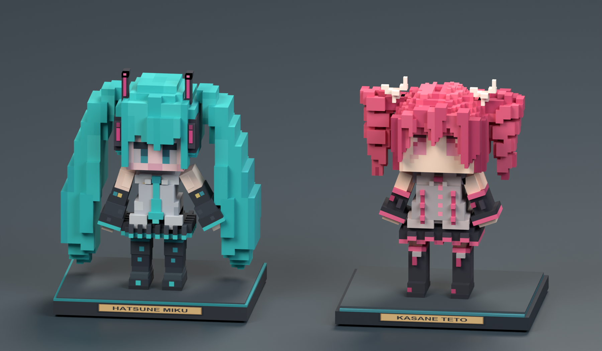
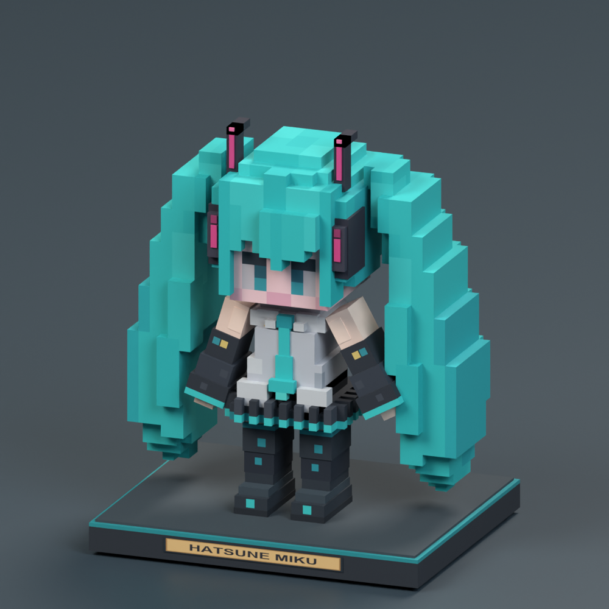
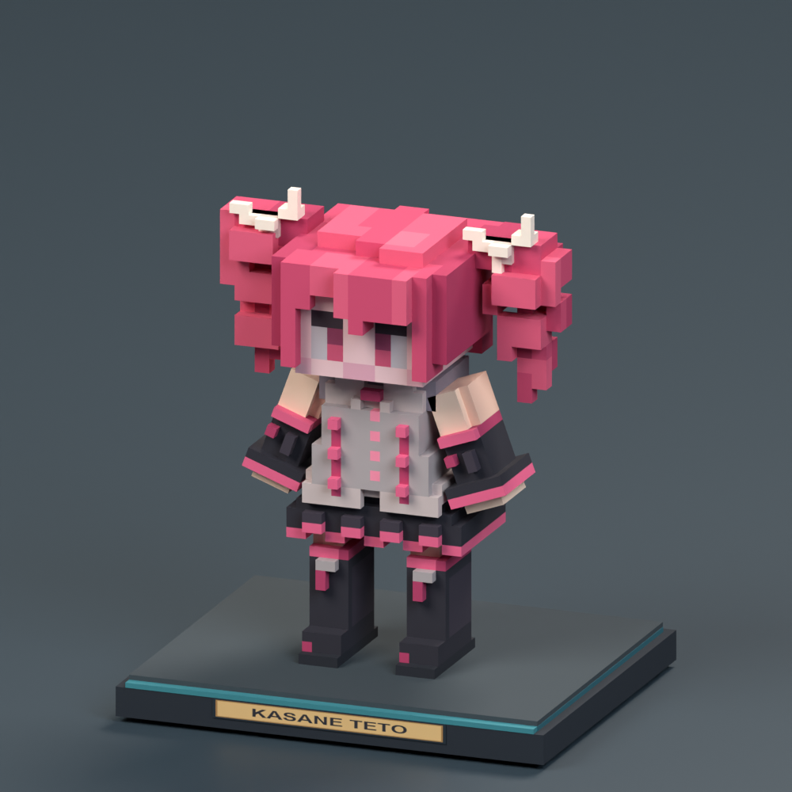

# Arcade Pass, Credits and collectible prizes

## Playing the loop

1. Open the existing Arcade Ordering Kiosk and choose **Passes**. **Get an Arcade
   Pass** issues a free blank card into the **To** slot if you do not have one.
   Otherwise, put the actual card you want to use into **To**.
2. Each material button
   trades **one** item from your inventory or offhand and adds the displayed
   amount to the inserted **To** card. The card's name and balances appear
   beside its slot; hover the item for its design and identity. Credits and
   Prize Points are different balances.
3. To combine cards, insert the card to drain into **From**, and the card to
   keep using into **To**, then transfer and confirm. All Credits and Prize
   Points move together. **From** becomes empty of funds, but both cards,
   their names, designs and identities remain available to keep or trade.
   Replacing either card cancels the confirmation. Cards in the rest of your
   inventory are not selected for the transfer.
4. Hold a pass and right-click any of the twelve full-size arcade cabinets.
   An offhand pass works when the main hand is empty. A successful play spends
   Credits and awards a randomized rank and Prize Points, with a result message,
   note-block chime/bell and particles. The existing idle geometry, textures,
   lights, disc playback and empty-hand seat/drum interactions are preserved.
5. Return to **Prizes**, insert the card to pay with into **To**, and order a collectible.
   Delivery goes into your inventory or safely onto the ground if full.

The two slots hold real items for your own kiosk session. Shift-click a pass
to insert it into **To** first, then **From**; shift-click an inserted card to
take it back. Closing the kiosk returns both cards to you, with overflow
delivery if necessary. Switching tabs retains the inserted cards; the
**Machines** tab does not insert passes into hidden slots.

Gachapon keeps its separate operator-stocked currency/reward system. The kiosk
and prize figures do not award play points. Creative players pay the same
prices when using this loop. Cards are transferable bearer items, so their
balances travel with them when dropped, gifted or stored.

## Default economy

| One material | Credits received |
| --- | ---: |
| Iron ingot | 20 |
| Gold ingot | 60 |
| Emerald | 120 |
| Diamond | 240 |

Every machine initially costs **10 Credits** per play. A player can play once
every **60 ticks (3 seconds)** across all cabinets and held passes.

| Result | Default probability | Prize Points |
| --- | ---: | ---: |
| C | 45% | 10 |
| B | 30% | 20 |
| A | 18% | 40 |
| S | 6% | 80 |
| SS / Perfect | 1% | 150 |

These are simulated results, independent of the decorative game on the screen.
The server commits the debit and award together, before audiovisual feedback.
There is no charged-but-unpaid pending round to lose on disconnect or restart.

## Configuration

NeoForge generates **`funpackcustom-arcade-economy.toml`** as a SERVER config and
syncs it to joining clients. The verification server writes it under `config/`.
Edit the server's generated file while it is stopped, then restart. The checked-in
[default example](economy-defaults.toml) documents all values; it is not loaded
as a second configuration. `ArcadeEconomyConfig` owns the runtime values.

- `[exchange]`: Credits per iron ingot, gold ingot, emerald or diamond.
- `[play]`: default cost, cooldown, weighted rank rows and machine overrides.
- `[prizes]`: point price for each collectible in the prize catalog.

Rank rows use `profile|label|weight|points`; weights are relative within their
profile. Add a new profile's rows and assign it to a cabinet with
`namespace:machine|cost|profile`. For example, retain the standard rows and add
`"expert|A|3|100"` and `"expert|S|1|250"`, then use
`machineOverrides = ["funpackcustom:initial_d|25|expert"]`.
Unknown profiles fall back to `standard`; an absent usable standard profile
disables play rather than silently inventing awards. Up to 64 rank rows per
profile are supported. Omit a rank row to remove that result.

Balances are bounded to **1,000,000,000** each. An exchange, transfer, or play
that could exceed that bound is rejected without losing value.

## Data and future additions

The nonstackable card stores the persistent and network-synchronized
`funpackcustom:arcade_pass` data component: schema version, unique card ID,
design ResourceLocation, Credits, Prize Points and transaction revision.
Optional fields and the schema version leave room for later statistics,
mastery, achievements and collection tracking. Design IDs are independent of
balances; transfers preserve unknown designs and all other item components.
Only **Arcade Original** has artwork in this version.

No dungeon loot or extra designs are injected yet. Future loot can set only
the desired fields, with safe defaults for the rest. For example, a command
for testing a found card is:

```mcfunction
/give @s funpackcustom:arcade_pass[funpackcustom:arcade_pass={credits:75L,design:"funpackcustom:default"}]
```

Its ID is assigned on its first kiosk insertion or balance mutation. Gameplay requests identify
the fixed kiosk pass slot, card ID and revision; they never supply a price,
reward amount, resulting stack, or trusted balance. The server validates the
nearby bound kiosk, player, card and available funds, then commits snapshots
atomically. Failed/stale requests, canceled item spawns and recursive spawn
callbacks cannot duplicate a purchase or erase payment. Transfers keep **From** as
a real empty collectible instead of consuming it.

## Collectible art

The Arcade Pass uses reference-based red-and-white e-amusement artwork,
following the user's supplied KONAMI card reference. The authored transparent
PNG is retained unchanged as `arcade-pass-source.png`, and the preview is a
byte-identical copy. The runtime item receives technical square padding and
aspect-preserving downsampling, with the source alpha retained and no redrawing.
This cosmetic update retains the existing `funpackcustom:default` design ID
and all pass functionality. The [artwork notes](arcade-pass-artwork.md) retain
the reference provenance and final image-generation prompt.
The two small placeable prizes follow the user's Miku and Teto figure references.
The pass is an inventory item; the figures are three-dimensional decorations.

| Prize ID | Display name | Default points |
| --- | --- | ---: |
| `hatsune_miku_figure` | Hatsune Miku Figure | 2,500 |
| `kasane_teto_figure` | Kasane Teto Figure | 2,500 |

Point prices are owned by the arcade economy configuration, not embedded in
the models or `ArcadePrizeCatalog`. Prizes have no crafting recipes. Each drops
one copy of its own item when normally broken. Figures have no block entity,
playable game, music inventory, or reward interaction.

Both models fit inside one block, below Y15/16. The block class uses a shared
compact X2–14, Y0–15, Z3–13 collision/selection envelope and horizontal facing.
Each chibi figure has a layered outfit, pixel eyes, stepped voxel hair, boots, a
dark display base with teal trim, and a named plaque. Miku has long teal
twin-tails and a black/pink headset. Teto has pink drill curls and white bows.

The initial poster, cat plush, trophy, and miniature cabinet were removed at
the user's request, including their registry entries and runtime assets.
Existing copies of those retired items/blocks are not migrated to the figures.

The current figures are built from cuboids, with interior voxel faces removed.
Miku's hair uses equal-sided 0.375-unit cubes at its final head width, with
broader clumps and fewer surface stripes. It is not compressed horizontally
after construction. Finer clothing details and Teto's hair use a quarter-unit
grid. Hair, tunic hems, skirt pleats and boots have square steps; cuboid sleeves
are posed at angles. Face pixels stay flat and square. See the
[reference construction notes](figure-reference-notes.md) for the supplied
sheets and the visual details used during the rebuild.

The prior model version is retained under Git tag
`figures-before-voxel-rebuild-2026-10-06`. Its [saved preview and restore notes](rollback/pre-voxel/README.md)
allow a later appearance rollback without undoing unrelated gameplay work.

## Files and rebuild

- `scripts/miku_figure_geometry.py` and `scripts/teto_figure_geometry.py` author
  the two figures, using the palette mesh helpers in `scripts/figure_geometry.py`.
- `scripts/make_arcade_prizes.py` generates palette/nameplate textures, native OBJ/MTL,
  model wrappers, blockstates, inventory models, normal loot tables, source
  geometry, embedded-texture Blockbench files, and `art-lang.json`.
- `scripts/render_arcade_prizes.py` renders those source meshes directly and
  saves `arcade_prizes.blend`, with packed artwork and editable prize meshes.
- Each prize has `<id>.geometry.json`, `<id>.bbmodel`, and `<id>.png` here.
- `arcade-prizes.png` shows the two figures side by side at their actual scale.
- `miku-face-detail.png` shows the exported face and hair closely; regenerate
  just this view and Miku's front view with the renderer's `--miku-face-only`
  option. `--miku-only` refreshes all Miku views, the pair and packed scene;
  a full render also refreshes Teto's views.
- `arcade-pass-source.png` is the immutable authored card artwork, based on the
  user's red-and-white e-amusement reference. `scripts/prepare_arcade_pass.py`
  copies it byte for byte to the `arcade-pass.png` preview. For the runtime
  `assets/funpackcustom/textures/item/arcade_pass.png`, it crops only exterior
  empty padding using the alpha channel's nonzero bounding box, fits the card
  within 496 × 310 pixels with LANCZOS while preserving aspect ratio, then
  centers it on a transparent 512 × 512 canvas. Alpha is resampled with the
  image, never thresholded or painted; the generated-item model is unchanged.
- `art-lang.json` supplies display-name translation entries for integration
  into the shared language file. It is not loaded by Minecraft itself.

From the repository root, run `python scripts/make_arcade_prizes.py`, followed
by `blender --background --python scripts/render_arcade_prizes.py`. These
scripts do not regenerate or modify any existing arcade cabinet assets.
The figure generator leaves the pass artwork unchanged.
To update only the card preview and runtime texture, run
`python scripts/prepare_arcade_pass.py`. This standalone command does not
regenerate prizes, models, blockstates, or loot tables.

## Verification

On 2026-10-06, the Java 21 Build and all **103 dedicated-server GameTests**
passed. The suite includes exact figure purchases with configurable prices,
rejection of the four retired prize IDs, actual BlockItem placement in all four
facings, oriented collision, independent adjacent figures, and exactly one
self-drop from survival removal. The existing pass, transfer, credit-loading,
simulated-play, and machine tests also passed.

The models are generated from editable geometry, exported as NeoForge OBJ
meshes and Blockbench files, and rendered directly for the previews. Facial
features use flat pixel art to match the references, with compact chibi bodies,
large heads, layered hair, and small display bases.

The source meshes contain 4,620 Miku faces and 9,935 Teto faces. An isolated
NeoForge OBJ bake verified all four placed facings and both item models:
72,775 baked quads with finite coordinates, the expected UVs and ordinary
world lighting. The final JAR matches every source resource, contains 107
Java 21 classes, excludes retired assets and verification helpers, and leaves
the pass artwork byte-identical to the previous version.

Every exported figure surface is rectangular, including the posed sleeves.
Miku's final hair surfaces have equal 0.375-unit edges. The subsequent eye and
blush adjustment changed only 24 face-pixel palette assignments: every vertex
and all other materials stayed identical. The last fringe adjustment extends
the bangs by one hair cell and the inner side locks to the cheek line; its
face pixels, headset, twin tails and body remain identical.
The final eye layout uses one inner blue iris column, eye white outside it,
and face color at the outer edge, with all geometry preserved.

The small native client verified real 2,500-point purchases of both figures,
insufficient funds, physical pass-slot return, purchased-item placement,
survival recovery, opposite facings, cabinet play, and the minimum GUI size.
The native views below include the larger hair cubes and lowered face pixels,
captured before the last bang/side-lock extension and single-column iris edit.
The hair change passed Build, OBJ baking and direct model render checks; the
iris edit passed Build and a color-only mesh comparison. The studio views show
both changes. The earlier full copied-pack check passed with the same gameplay
code and the pre-voxel assets; its saved image is kept with that rollback.







