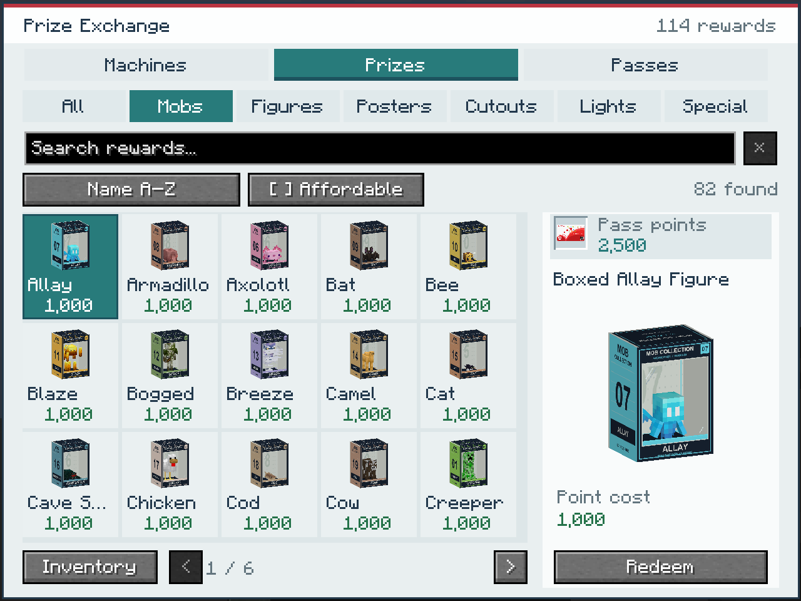
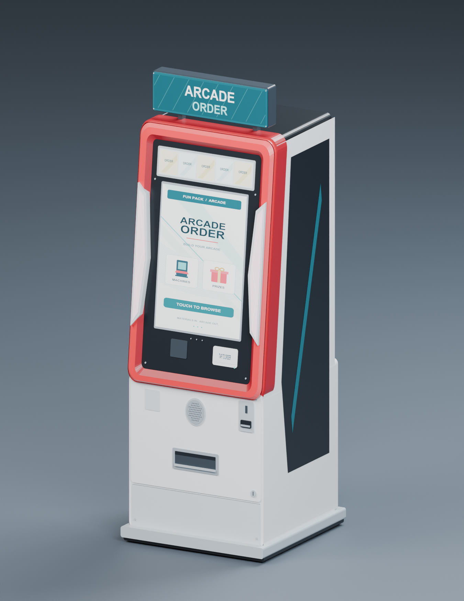
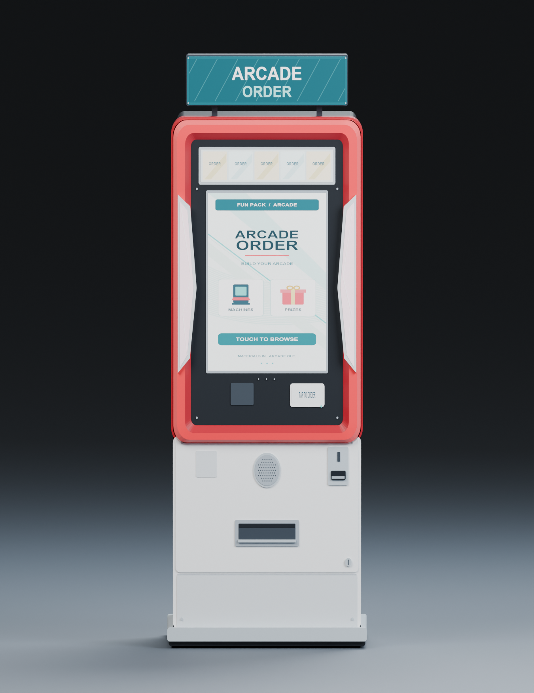
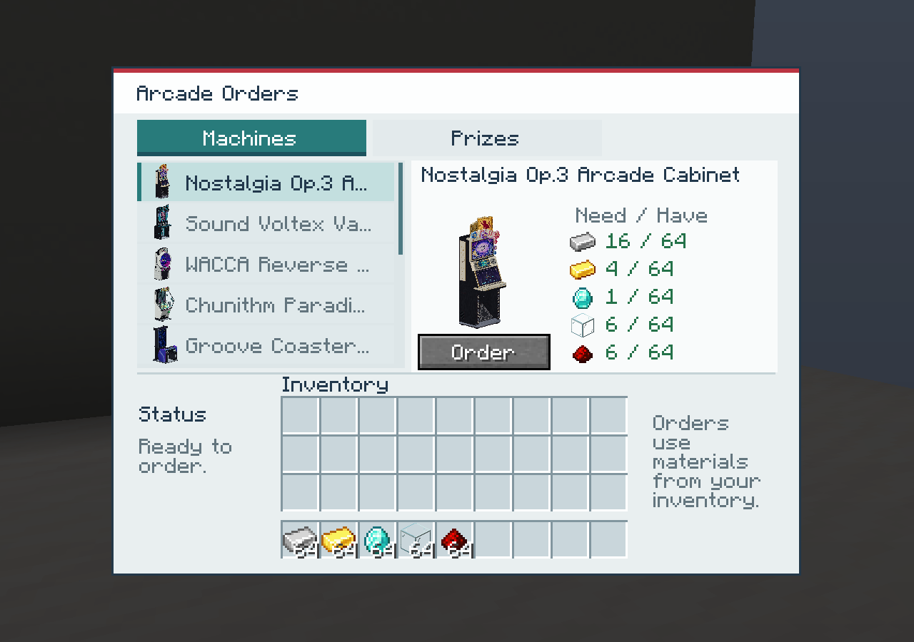
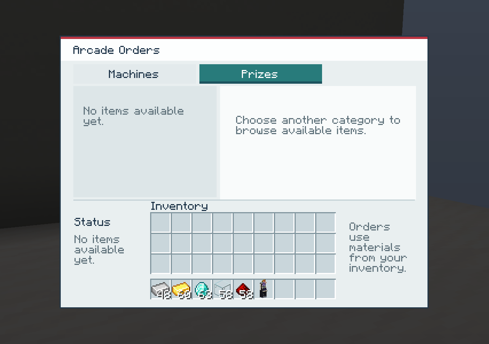
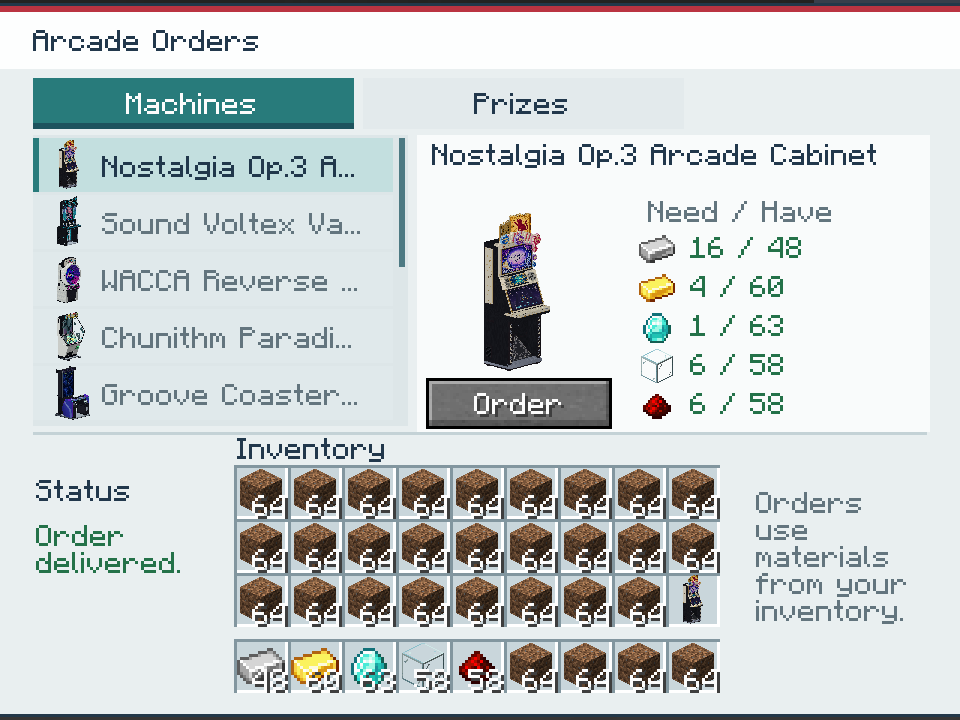

# Arcade ordering kiosk

An original ordering terminal inspired by the supplied Card Connect cabinet
reference: rounded red screen molding, a slightly leaning portrait display,
separate landscape banner, pale pink light fins, raised teal marquee, and a
white service pedestal with speaker grille and collection tray. The original
utility artwork reads **ARCADE ORDER**.

## Crafting and use

The kiosk is a public ordering station with a one-block footprint and two-block
height. Right-click either half to open it. It needs a solid floor and a clear
upper block when placed. Find it in **Japanese Arcades**, use
`/give @s japanesearcades:arcade_kiosk`, or craft it at a crafting table:

```text
Glass      Iron       Glass
Redstone   Gold       Redstone
Iron       Iron       Iron
```

This uses **4 iron ingots, 2 glass blocks, 2 redstone dust and 1 gold ingot** and
produces one kiosk. Obtaining iron unlocks its recipe-book entry.

The **Machines** tab lists the available arcade/gachapon machines. Click
an entry to see its preview and **Need / Have** material counts. Green counts
indicate enough of that ingredient; red counts identify shortages. **Order** is
enabled when the player can afford the complete price. Browse by scrolling the
list, using arrow keys, or pressing Home/End/Page Up/Page Down. Hover truncated
names or ingredient rows for their full labels.

An order immediately consumes the listed materials and gives one selected
machine. It uses inventory and offhand materials, combining stacks, and never
uses armor slots. Like ordinary crafting, a custom name on an ingredient does
not prevent it from being used. Delivery goes into the inventory, or drops near
the player if it remains full after payment. Creative players use the same
material transaction. Failed or unavailable orders leave ingredients untouched.
Ground purchases wait for inventory space even in creative mode, where vanilla
pickup would otherwise discard an item that cannot fit.

The **Passes** tab issues an Arcade Pass, trades iron/gold/emeralds/diamonds for
Credits on a card placed in its **To** slot, and transfers all Credits and
Prize Points from the physical **From** slot into **To** while keeping both
cards. Cards return to the player when the kiosk closes. The **Prizes** tab
redeems rewards using the inserted pass's Prize Points. See the
[Arcade Pass economy guide](../arcade_economy/README.md) for configurable prices
and the complete play/reward loop. Empty gachapon capsules are not sold:
filled capsules still come from stocked gachapon machines.

## Reward browser

The Prizes tab has **116 rewards**: 82 boxed mob figures, 20 posters, seven glow
sticks, two character figures, four cardboard cutouts and the mech suit. The
loose figures and empty boxes are obtained by unboxing; their separate item
forms do not duplicate the shop catalogue.

Browse **All, Mobs, Figures, Posters, Cutouts, Lights or Special**, search by
name, and sort alphabetically or by point price in either direction. Search
also recognizes item ID paths, ignores case/accents, and combines multiple words.
**Affordable** limits results to the inserted pass's current points. Filters
update when the pass balance or synchronized server prices change.

The paged thumbnail grid shows names and point prices, with a larger preview,
full reward name, pass balance and explicit **Redeem** action on the right.
Hover cards or the selected preview for full names and prices. The layout
adapts from a 320-by-240 GUI to a 440-by-316 panel, displaying six to eighteen
rewards at once. It draws only the current page and one selected preview.

Choose **Insert pass** / **Inventory** to open the inventory drawer, then
shift-click an Arcade Pass into the visible pass slot. Choose **Browse** to
return to the grid. Inventory slots are hidden and cannot be clicked through
the grid. Closing the kiosk returns deposited passes as before.

Use the mouse wheel/page buttons to browse pages, arrow keys to select cards,
Page Up/Down and Home/End to jump, or Ctrl+F to focus search. Typing in search
does not activate inventory/hotbar/drop bindings; Tab leaves the field and
Escape releases search focus. A subsequent Escape closes the kiosk.

Purchases still send stable reward IDs through the existing server-validated
transaction path; filtering never changes the item a purchase refers to.



Additional native screenshots show [search](reward-search.png), the
[minimum-size browser](reward-browser-minimum.png), and the
[inventory drawer](reward-inventory-drawer.png).

The 2026-10-08 reward-browser update passed the Java 21 release build and all
**211 dedicated-server GameTests**. An isolated native client passed **530
checks** across all 114 rewards, including an actual filtered Warden purchase
with exact point deductions, pass insertion/return, live affordability changes,
keyboard navigation, selection preservation when resized to 320-by-240, pass
exchange/transfer, and machine ordering. The client exited cleanly. This update
was checked in the small client; the older full-pack checks below apply to the
original kiosk. No build was installed in the original instance or its saves.
See the [verification receipt](reward-browser-verification.json).

## Material prices

| Machine | Iron | Gold | Diamond | Glass | Redstone |
| --- | ---: | ---: | ---: | ---: | ---: |
| Nostalgia, Chunithm, Groove Coaster, MUSECA, Project DIVA | 16 | 4 | 1 | 6 | 6 |
| Sound Voltex Valkyrie | 18 | 4 | 1 | 6 | 8 |
| WACCA | 16 | 4 | 1 | 8 | 6 |
| Chrono Circle | 18 | 4 | 1 | 8 | 8 |
| maimai DX, DDR SuperNOVA | 24 | 6 | 2 | 8 | 8 |
| Taiko no Tatsujin | 20 | 4 | 1 | 6 | 6 |
| Initial D single | 20 | 4 | 1 | 6 | 6 |
| Gachapon | 8 | 2 | 0 | 4 | 2 |

Iron and gold quantities are ingots; glass is full glass blocks. Prices are
defined in the shared catalog, and the server resolves every order against that
catalog. The client sends only the selected entry and current menu identifier.





## Assets

- `arcade_kiosk.bbmodel`: editable Blockbench mesh project with embedded artwork.
- `arcade_kiosk.blend`: editable Blender scene, grouped by physical assembly,
  with packed original textures, lights, floor, and camera.
- `geometry.json`: full source meshes, UVs, materials, bounds, and face counts.
- PNG previews render the actual exported geometry with studio lighting.

The station uses one horizontal block and two vertical blocks. Geometry bounds
are X **2.579–13.421**, Y **0–32**, Z **2.6–13.75**, in Minecraft model units
(16 units per block). The narrow cabinet fits comfortably inside its placement
footprint. Its north-facing front points toward negative Z. The screen assembly
leans back by about **6 degrees** while the lower pedestal stays vertical.

Runtime geometry is clipped with interpolated UVs at Y=16. The upper model is
translated into its upper block's local coordinates. All four facing rotations
are defined for both block halves. This is a static block model and requires
no per-frame block-entity renderer.

## Rebuilding

Run `scripts/make_arcade_kiosk_model.py` with Python and Pillow to regenerate
the three original textures, the lower and upper OBJ models, whole item model,
blockstate variants, geometry source, and Blockbench project. It imports the
existing `ddr_mesh_export` UV clipping helpers; no other cabinet is modified.

Run Blender in background mode with
`--python scripts/render_arcade_kiosk_model.py` to regenerate both previews and
the packed Blender project. The authoring scripts use the standard Windows
Arial fonts for their original utility graphics.

The generator checks finite model bounds, nondegenerate faces, unique authoring
names, and complete UVs. The native NeoForge 21.1.252 OBJ bake audit verified
**25,096 baked quads** across both halves in all four directions and the item
model, preserving every source face and UV, correct texture V orientation, and
fullbright screen/light materials. The isolated audit does not exercise resource
startup or texture atlas upload; live-client validation is performed separately.

There are **3,934 lower-half**, **1,136 upper-half**, and **4,816 whole-item**
source faces. Split faces are clipped rather than duplicated across blocks.

## Verification

The Java 21 release build and all **103 dedicated-server GameTests** passed on
2026-10-06. Nine kiosk tests cover both block halves in all directions, support
and obstruction handling, every catalog purchase, split/offhand payments,
invalid or stale requests, survival/creative overflow, canceled or substituted
drop events, delayed pickup after save/reload, and the loaded shaped recipe.
Ten additional kiosk economy tests cover pass issuance, exchanges, transfers,
prize purchases, card persistence, transaction isolation and live rebalancing;
six paid-play tests cover the cabinets and pass data. Four more tests cover real
pass-slot interactions, stale reinsertion, viewer isolation, safe returns on
close/removal/logout/death, canceled overflow recovery and mid-delivery card swaps.
Current economy UI
screenshots and checks are in the [economy guide](../arcade_economy/README.md).

The packaged JAR was checked against all 16 relevant source resources, including
models, textures, crafting/loot/advancement JSON, translations, and the pickaxe
tag. Existing translations were preserved. All kiosk classes target Java 21.

The original kiosk implementation's disposable small-client world verified
the development status command, the actual kiosk model
and screens, a disabled unaffordable order, a paid purchase with exact ingredient
deductions, list scrolling and long titles, the empty Prizes tab, safe creative
overflow followed by pickup after freeing a slot, and the minimum logical
**320 x 240** screen size.

The same checks also passed in a fresh world with the complete copied pack
(218 copied mod JARs and its configuration/content folders), including JEI and
the pack renderer. Both test clients exited cleanly. No original-instance
files or saves were changed. The full-pack images are
[the placed kiosk](kiosk-in-pack.png) and
[ordering alongside JEI](kiosk-ordering-in-pack.png).

These are actual Minecraft screenshots from the original kiosk implementation,
before the Passes tab and collectible prize shop were added:







