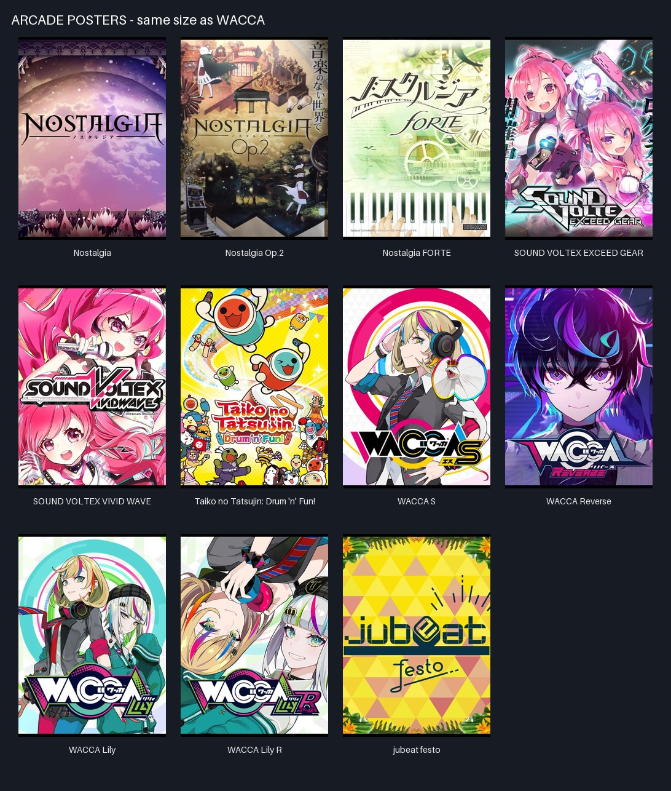

# Arcade poster collection

These eleven user-supplied prints use exactly the original WACCA poster's physical
size: **1 block wide × 4096/2979 blocks tall** (about 1⅜ blocks). Each has a separate
item identity, follows the same wall placement and recovery behavior, and retains
its own artwork. The original WACCA poster is unchanged.

| Item ID | Artwork |
| --- | --- |
| `nostalgia_poster` | Nostalgia |
| `nostalgia_op2_poster` | Nostalgia Op.2 |
| `nostalgia_forte_poster` | Nostalgia FORTE |
| `sound_voltex_exceed_gear_poster` | SOUND VOLTEX EXCEED GEAR |
| `sound_voltex_vivid_wave_poster` | SOUND VOLTEX VIVID WAVE |
| `taiko_drum_n_fun_poster` | Taiko no Tatsujin: Drum 'n' Fun! |
| `wacca_s_poster` | WACCA S |
| `wacca_reverse_poster` | WACCA Reverse |
| `wacca_lily_poster` | WACCA Lily |
| `wacca_lily_r_poster` | WACCA Lily R |
| `jubeat_festo_poster` | jubeat festo |

All IDs use the `japanesearcades` namespace.

Each print is available in the Arcade Ordering Kiosk's **Prizes** tab for **750
Prize Points** by default and in the Japanese Arcades creative tab. Prices are
individually configurable with `prizes.<item_id>` in
`japanesearcades-arcade-economy.toml`. Use a print on a supported wall to hang it;
survival removal returns the same print for rehanging.

## Source preservation and regeneration

The JPEGs in `sources/` are byte-identical copies of the eleven supplied attachments.
`manifest.json` records their original attachment filenames, SHA-256 hashes, source
dimensions, exported texture hashes, geometry dimensions, and verification results.

Run `python scripts/make_arcade_posters.py` with Pillow to regenerate the assets and
review contact sheet. On first import, pass `--source-directory` with the directory
containing the original attachment filenames. The script refuses to replace an
existing source with different bytes.

Each source is **528 × 704 pixels**. The full image is uniformly downsampled with
Pillow LANCZOS to **512 × 683 pixels**, then placed on a **512 × 704** black canvas
with **10 pixels above and 11 below**. Nothing is cropped, repainted, or enlarged.
Nearest-pixel canvas sizing has a 0.0031% aspect-ratio rounding difference from the
exact physical rectangle. Both texture dimensions are multiples of 64, preserving
Minecraft's default four atlas mip levels. The black edge matches the original
WACCA poster's treatment.

Both the painting atlas and item atlas receive identical PNG bytes. Inventory and
held models copy the original WACCA poster's exact geometry and transforms: width
`15 × 2979/4096`, height `15`, thickness `0.12` model units. Each item has **6 faces**.
Placed posters use the shared vanilla painting renderer's **1 × 2 support grid**
at the fractional visual height, or **12 quads** including backing and thin edges.

The exporter checks decoded artwork pixels against the full-image downsample,
immutable source hashes, atlas equality, mip divisibility, exported item dimensions,
and face counts.
`contact-sheet.jpg` is a review-only composition of the final textures.

## Runtime verification

`dev.cmd Build` and all **202 required GameTests** pass. The collection tests
exercise each print in all four wall directions, save/reload, correct pick/drop
items, support loss, rejected placement, and spacing beside other prints and
the original WACCA poster. The kiosk transaction test redeems all 30 prizes,
including every poster, at their configured prices and rejects stale requests.

The isolated native client passed **122 checks** covering the twelve-poster
gallery, exact rendered dimensions, black edges/backing, texture atlas sprites,
and lightweight inventory models. The block/item atlas retains four mip levels.
Reviewed screenshots and release provenance are under `native/`; the final
release differs from the photographed build only in two GameTest fixture classes.

