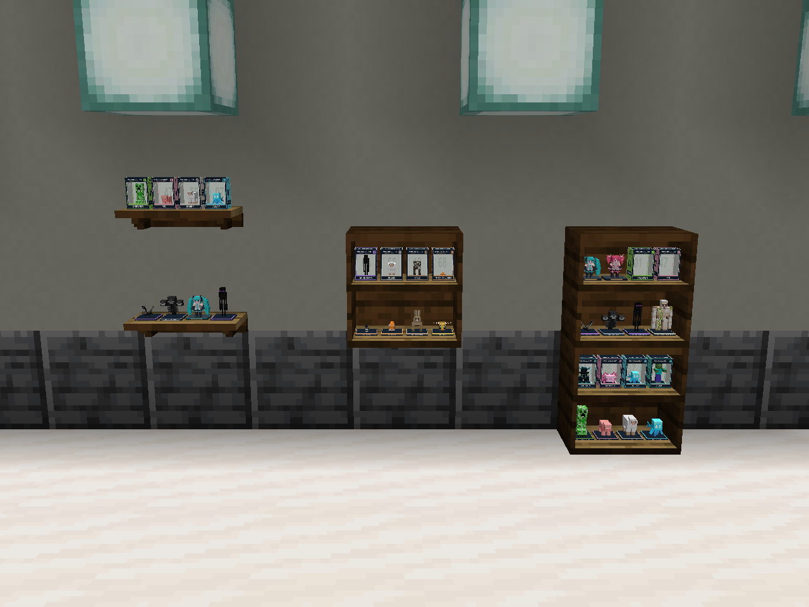

# Figure shelves

Two craftable display blocks use vanilla dark oak and oak plank textures, so they add no raster textures or animation work. Their static geometry is chunk rendered; the small collectibles are rendered separately by the block entity renderer.

- **Figure Display Unit** is a one-block-wide, one-block-high cabinet with two rows of four collectibles. It can sit on a floor, mount against a wall, or stack into a larger display. The dark oak sides and back frame warm oak boards.
- **Figure Wall Shelf** is a shallow single-row shelf with four collectible positions, a dark front edge, rear mounting rail, and two stepped wooden brackets.

Right-click opens a compact inventory. Each display slot holds one collectible. The menu rows map directly to the visible shelf rows, from left to right when viewed from the front. Shift-click fills available spaces and keeps any remainder in the player's inventory. Sneak while holding another block to place against a unit without opening its inventory.

All 246 mob collectible forms (loose figures, boxed figures and empty boxes), plus the Miku and Teto figures, fit the displays. Stored items retain their names and other components. Unrelated items and nested custom display boxes are rejected. No hopper access is exposed. Breaking a shelf, removing its support or an explosion releases its contents once; canceled item spawns use the existing persistent recovery queue.



Close views: [stacked display units](stacked-display-units.png), [wall displays](wall-displays.png), [two-row inventory](display-inventory.png), and [single-row inventory at minimum GUI size](wall-shelf-inventory.png).

## Geometry

All measurements below use Minecraft model units (16 units = 1 block), for the north-facing model with its front toward negative Z.

| Model | Geometry bounds | Display surface heights | Static exported faces | Inventory faces |
| --- | --- | --- | --- | --- |
| Figure Display Unit | X 0–16, Y 0–16, Z 6–16 | Y 1 and 9 | 25 | 25 |
| Figure Wall Shelf | X 0–16, Y 0–3, Z 8–16 | Y 3 | 27 | 27 |

Display centers are X 2.5, 6.1667, 9.8333, and 13.5, with enough clearance from the outer side panels. The display unit uses Z 10.5; the single shelf uses Z 11.5. The unit's side panels are X 0–0.65 and 15.35–16, with a back panel at Z 15–16. Interior boards are Y 0–1 and 8–9. The top cap is Y 15–16. Adjacent hidden board faces are omitted; exposed top and bottom back-panel surfaces are retained.

The item models inherit the same small cuboid models. Blockstates rotate the north model 90° east, 180° south, and 270° west. No new texture sheets are required.

## Crafting

The display-unit recipe makes two units from six planks and two wooden slabs:

```text
Plank  Slab   Plank
Plank         Plank
Plank  Slab   Plank
```

The wall-shelf recipe makes three shelves from three wooden slabs and two sticks:

```text
Slab   Slab   Slab
Stick         Stick
```

Any vanilla-compatible plank or wooden slab tag works. These are ordinary furniture recipes and do not add entries to the reward catalog. Both blocks are axe-mineable and drop their own block item. Stored collectibles are released by the block entity removal path, without duplicating them into the loot table.

## Rendering

Collectibles keep their proportions and face forward. The renderer measures each baked model once, fits it within a 3.15-by-5.7-by-6 model-unit cell, and reuses the existing shared display mesh cache. Fit caches clear on resource reload. Only occupied cells render, with a 24-block view distance, and neither shelf has a block-entity ticker. The static face counts above exclude the displayed collectible models; scaling a figure does not reduce its polygon count.
