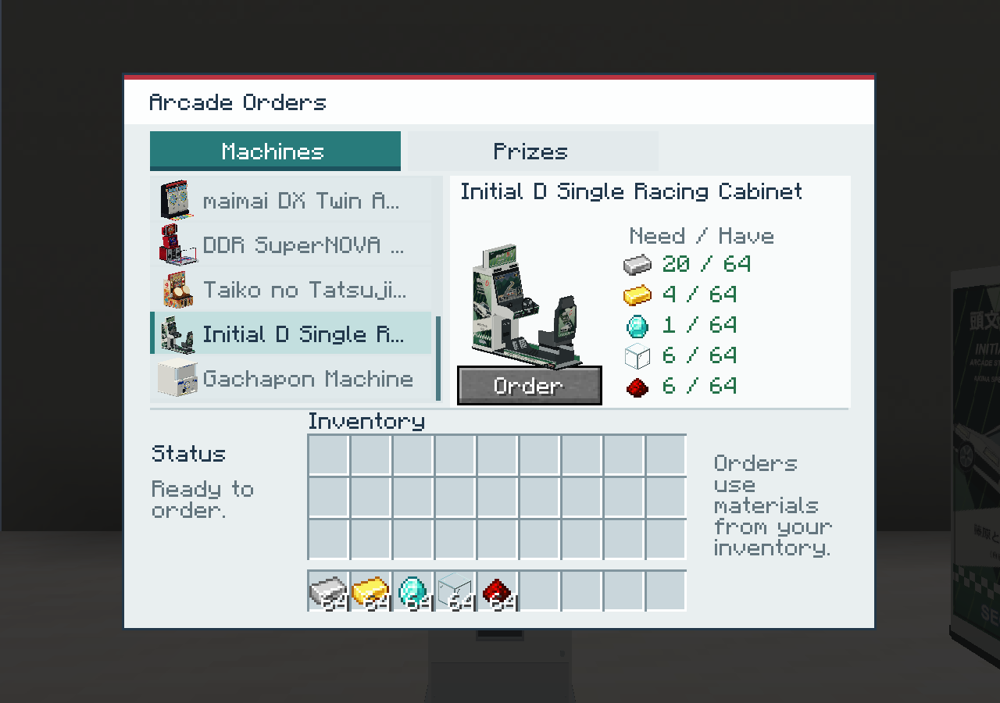

# Initial D single racing cabinet

A single-player Initial D Arcade Stage 3 cabinet, with a cream shell,
green-and-black racing graphics, a sloped monitor, steering wheel, shifter,
pedals, a bucket seat, and its own illuminated marquee.

The design uses the [SEGA Arcade Stage 3 owner’s manual](https://initiald-arcade.com/pdf/v3-twincabmanual.pdf)
and [single-cabinet reference photographs](https://zenius-i-vanisher.com/v5.2/viewpicture.php?pictureid=64319)
for its layout. The texture art is drawn for this mod rather than copied from
photographs. The modeled unit is independent, without a shared twin marquee.

## Placement and obtaining

Each item places one machine in a **1-block-wide, 3-block-deep** supported
footprint. The rear cabinet is **3 blocks tall**. Every part stays inside its
one-block width, including the seat, dashboard, shifter, and marquee, so units
can sit directly beside each other without overlapping shells.

Find **Initial D Single Racing Cabinet** in **Japanese Arcades**, use
`/give @s japanesearcades:initial_d`, or order it from the Arcade Ordering Kiosk's
**Machines** tab for **20 iron ingots, 4 gold ingots, 1 diamond, 6 glass blocks,
and 6 redstone dust**.

## Seat and music discs

Right-click the seat with an empty hand to sit facing the monitor. Sneak to
dismount. One player occupies each seat, and each neighboring cabinet keeps
its own seat and music-disc inventory.

Use the rear cabinet to insert or eject a music disc. This is a decorative
racing cabinet with a usable seat and music playback, rather than a driving
minigame.

## Sources and verification

The Java 21 release build and all **80 dedicated-server GameTests** passed on
2026-10-06. The seven Initial D tests cover every section in all four facings,
adjacent-cabinet isolation, blocked placement and missing support, actual
server-ray seating, seat occupancy, shift dismounts and a full row's rear exit,
held-item/range/spectator/headroom rejection, removal/logout cleanup, and saved
music-disc playback while seated. The kiosk tests also purchase this cabinet
for its exact material costs.

The release JAR was checked against all **28 relevant source resource files**,
all 28 directional blockstate variants, Java 21 class versions, and the model's
one-block width. Existing translations are preserved; editable art and the
disposable client probe are excluded from the release.

The disposable small client passed real mouse interaction and passenger sync,
occupied-seat rejection with a second server player, Shift-key dismount into
the rear aisle of three touching cabinets, removal of a neighboring machine
while seated, and the kiosk's exact paid transaction. The driver view and
seated avatar were inspected, and the client exited cleanly.

The same checks passed in the copied **218-mod pack**, including its renderer,
shaders, and JEI. Three adjacent single machines and the seated avatar rendered
correctly, the order delivered one cabinet and charged the exact ingredients,
and the pack client exited cleanly. The disposable fixture used the pack's
10 GB heap, eight active processors, and disabled Distant Horizons background
generation to keep the check within this host's memory. Original-instance
files and saves were untouched.

### Editable geometry and rebuild

The native source mesh is `geometry.json`, with editable embedded-texture
`initial_d.bbmodel` and a packed `initial_d.blend` studio scene. Previews are
`initial-d.png`, `initial-d-front.png`, `initial-d-seat.png`, and
`initial-d-paired.png`. The pair preview places two independent single machines
exactly one block apart, rather than creating a separate twin-cabinet asset.

Regenerate runtime OBJ models, section wrappers, blockstates, the item model,
and the Blockbench file with `python scripts/make_initial_d_model.py` from the
repository root. It uses `scripts/initial_d_geometry.py` for mesh construction
and seven-cell clipping, and `scripts/initial_d_textures.py` for original
printed artwork. Render the same source geometry and save the packed Blender
scene with `blender --background --python scripts/render_initial_d_model.py`.

Coordinates are sixteenths of a Minecraft block, with the machine facing north
(negative Z). The final visible bounds are X **0.32–15.68**, Y **0.05–41.0**,
and Z **−31.39–15.10**. The marquee ends at Y41, the cushion center is
approximately **(8, 11.55, −24)**, and the backrest reaches Y28.1. The steering
wheel is centered at **(7.1, 20.2, −7.4)** and leans back 16 degrees. The gray
seat includes separate rounded cushion bolsters, inclined back upholstery,
headrest, harness slots, slider rails, and a rear branding panel.

The source contains **3,794 faces**. Seven runtime sections clip geometry at
Y16/Y32 and Z−16/Z0 while interpolating UV coordinates, producing **4,039
section faces**. Every section remains within its own block. The full item
retains the complete connected machine as one scaled native OBJ.

The isolated NeoForge 21.1.252 OBJ bake audit passed **19,950 baked quads**
across all four facings of all seven sections plus the inventory item. It
verified unchanged face counts, finite coordinates, UVs, texture V orientation,
and fullbright screen/marquee lighting. Its report is
`build/verification/initial-d-obj-bake-audit.json`; actual client atlas loading,
placement, and seating require the separate runtime checks below.
