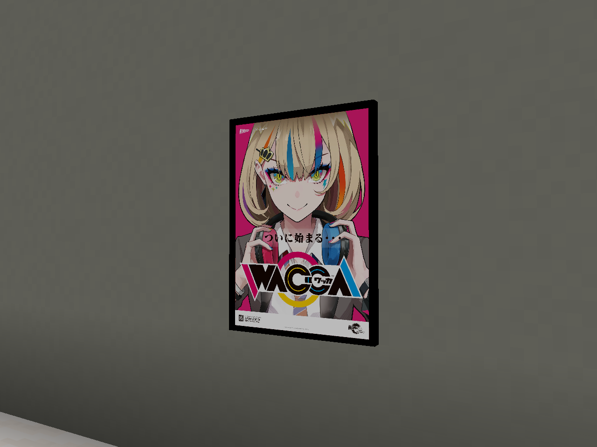

# WACCA poster prize

The **WACCA Poster** is a wall decoration purchased in the Arcade Ordering Kiosk's
**Prizes** tab for **750 Prize Points** by default. Insert an Arcade Pass into the
**To** slot, select the poster, and order it. Its price is configurable as
`prizes.wacca_poster` in `funpackcustom-arcade-economy.toml`.

The poster is **1 block wide and about 1⅜ blocks tall**, matching the source image's
aspect ratio. Use it on a solid wall with space in front of two vertical blocks. It
behaves like a painting: it hangs just in front of the wall and needs support.
The thin edge and backing are black, matching the artwork's border.
Breaking it in survival or removing its supporting wall returns one WACCA Poster
for rehanging. Creative removal does not create extra drops. The poster is also
available in the Japanese Arcades creative tab and through
`/give @s funpackcustom:wacca_poster`.

The poster always uses this artwork. It is absent from the ordinary painting
selection pool and has no crafting recipe.

## Artwork and regeneration

`source.jpg` is an unchanged copy of the user-supplied `WaccaPoster.jpg`.
`source.json` records its hash and the runtime texture preparation. The full image
is uniformly resized to 1024 × 1408, preserving its original proportions and
border. No additional padding is added. No artwork is generated, repainted,
cropped, or stretched.

Run `scripts/make_wacca_poster.py` with Python and Pillow to rebuild the painting
texture and flat, proportioned inventory model. The original source stays intact.
The custom entity reuses Minecraft's painting behavior, with matching visual and
selection bounds of 1 × (4096 / 2979) blocks. A small renderer adjustment fits the
image to those bounds; the backing variant uses a 1 × 2 wall-support grid. Its
item and drops retain the WACCA prize identity. A separate copy of the texture in
the item atlas supplies the kiosk and inventory icon.

## Verification

The build and all **116 GameTests** passed on 2026-10-06. Four poster tests exercise
placement in all horizontal directions, saved position/artwork, dedicated-item
recovery, creative use, support loss, blocked or overlapping placement, and
canceled entity spawning. The shared prize transaction test also verifies its
configured price, insufficient points, exact delivery, and stale request rejection.

The source hash, prepared pixels, matching item texture and model aspect ratio
are checked by the artwork preparation script.

Native client verification covers the painting and inventory textures, exact
dimensions, real kiosk purchase and point debit, survival placement, and recovery
of one poster. The final small-client check also captures the actual renderer in
all four directions, confirming that only the edge/back vertices are black.

The copied 218-mod pack passed the same purchase/placement/recovery checks on the
resized poster before the black-edge adjustment. The final JAR differs only in
the poster's client renderer and its private vertex-color wrapper; common code
and all assets are identical. The screenshots below show the final black edge.

